# ClinicFlow — Clinic Appointment Desk

**Rohan Ranjan · 24BCS10428 · DevOps Final Capstone Project**

ClinicFlow is the front-desk system of a small multi-specialty clinic. Receptionists book patients
with a doctor for a time slot, check them in when they arrive, mark the visit completed, or cancel
it. A doctor can never be double-booked: the database enforces one appointment per doctor per
slot, and the API answers `409 Conflict`. The dashboard shows the day's schedule, live counts per
status, and each doctor's load.

On top of the application sits the full DevOps chain from the course: tests → Docker → GitHub
Actions CI/CD with a Trivy security gate → images in GHCR → Terraform for AWS (VPC + EKS) →
Kubernetes via Helm (Ingress, HPA, probes, PVC) → Prometheus + Grafana with HTTP and business
metrics.

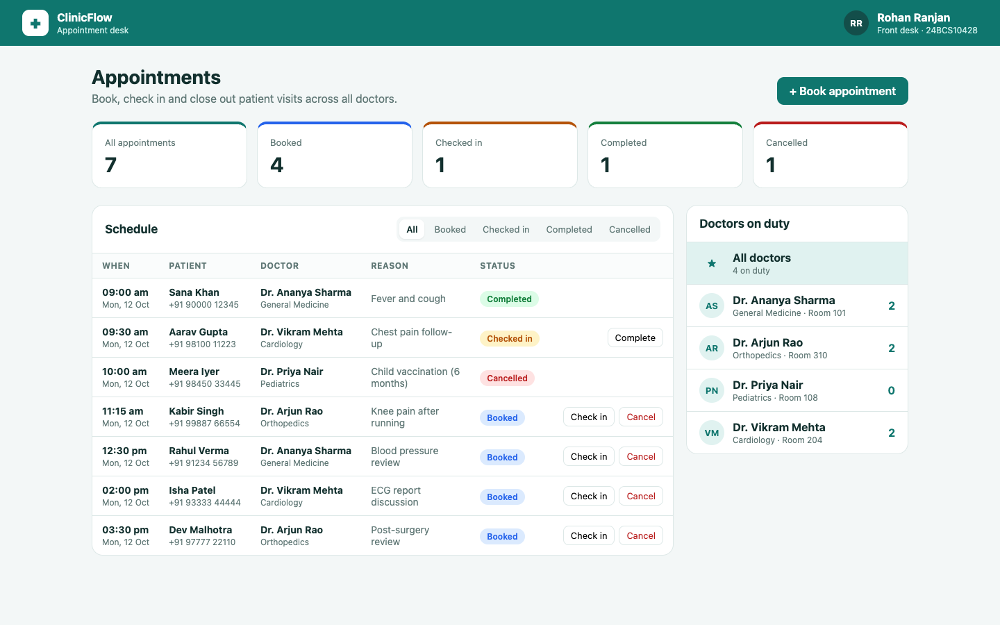

---

## Architecture

```text
 Developer ── git push ──> GitHub (RohanRanjan250/Devops-project)
                               │
                               ▼  GitHub Actions  (.github/workflows/ci-cd.yml)
                ┌──────────────┴───────────────────────────────────────────┐
                │ test:   pytest (16 tests, SQLite) + npm ci && vite build  │
                │ build:  docker build backend + frontend                   │
                │ scan:   Trivy  HIGH/CRITICAL (fixable) -> fail             │
                │ push:   ghcr.io/rohanranjan250/clinicflow-*:<commit sha>  │
                │ deploy: helm upgrade --install (when KUBE_CONFIG_DATA set)│
                └──────────────┬───────────────────────────────────────────┘
                               ▼
   Terraform ──> AWS: VPC (2 public + 2 private subnets, NAT) + EKS (managed node group)
                               │
                               ▼  Helm chart helm/clinicflow
        Ingress (nginx)  clinicflow.local
          ├── /      ──> frontend  Service ──> React build on nginx-unprivileged (x2)
          └── /api   ──> backend   Service ──> FastAPI (x2..6, HPA on CPU)
                                                   │
                                                   ▼
                                     postgres StatefulSet + PVC (Alembic migrations)
        ServiceMonitor ──> Prometheus ──> Grafana dashboard (ConfigMap, auto-loaded)
```

## Repository layout

```text
backend/            FastAPI app, SQLAlchemy models, Alembic migrations, pytest suite
frontend/           React + Vite single-page app, nginx config, multi-stage Dockerfile
docker-compose.yml  postgres + backend + frontend, with healthchecks
.github/workflows/  CI/CD pipeline
terraform/          AWS VPC + EKS (terraform-aws-modules)
k8s/                namespace
helm/clinicflow/    chart: deployments, services, ingress, HPA, StatefulSet, ServiceMonitor, dashboard
monitoring/         kube-prometheus-stack values
scripts/            load test + demo data seeding
troubleshooting/    deliberately broken manifests (lab)
docs/screenshots/   evidence for every module below
```

---

## M1 — Application (FastAPI + PostgreSQL + React)

| Method | Endpoint | Purpose |
|---|---|---|
| GET | `/health` | liveness (process is up) |
| GET | `/ready` | readiness (database reachable) |
| GET | `/metrics` | Prometheus metrics |
| GET / POST | `/api/doctors` | list / add doctors |
| GET | `/api/appointments?status_filter=` | schedule, optionally filtered |
| GET | `/api/appointments/{id}` | one appointment |
| POST | `/api/appointments` | book. `409` if the doctor's slot is taken, `404` for an unknown doctor |
| PUT | `/api/appointments/{id}` | reschedule / change status (`BOOKED → CHECKED_IN → COMPLETED`, or `CANCELLED`) |
| DELETE | `/api/appointments/{id}` | remove |
| GET | `/api/appointments/stats` | counts per status + doctors on duty |

Schema is managed by **Alembic**: `0001` creates `doctors` and `appointments` (with the
`uq_doctor_slot` unique constraint), and `0002` seeds the four doctors. The container runs
`alembic upgrade head` before starting Uvicorn. Migrations take a PostgreSQL advisory lock, so
several replicas starting at once don't race (I hit that race on Kubernetes, see M8).

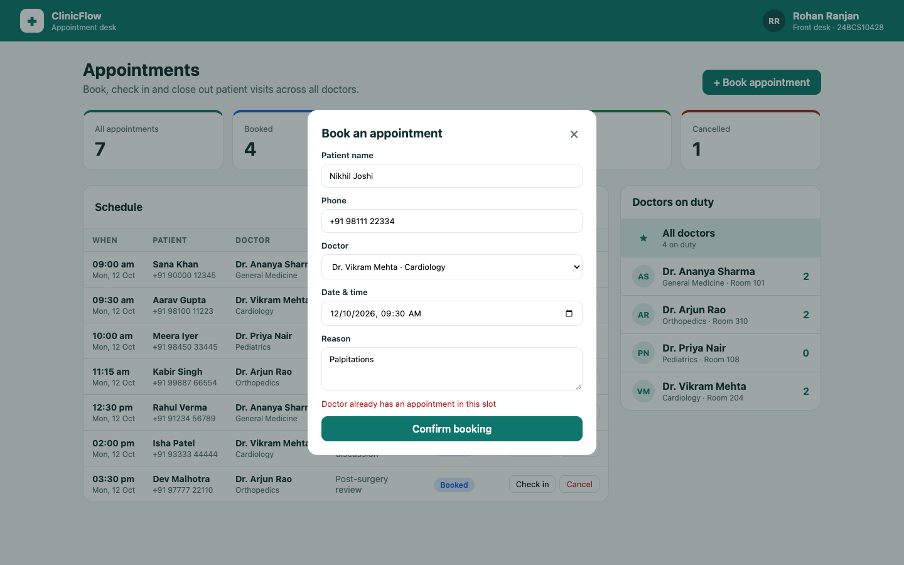

The booking form shows the API's `409` when a receptionist tries a slot that's already taken.

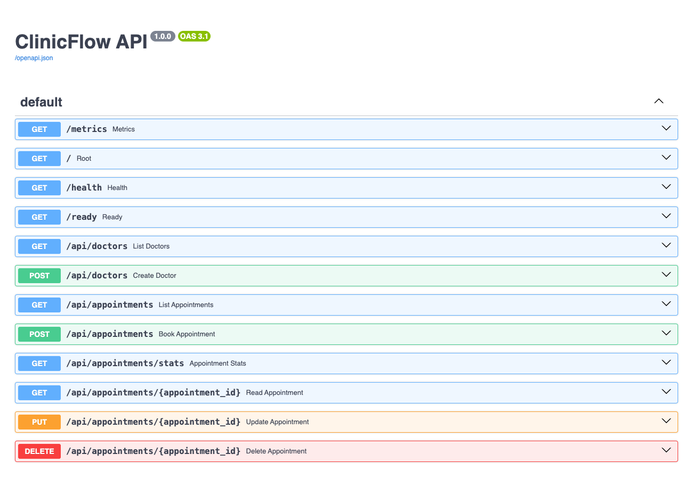

## M2 — Testing

`backend/tests/` has **16 tests across the health, doctors, appointments and metrics endpoints**:
booking, double-booking rejection, same slot with a different doctor allowed, unknown doctor
404, phone validation, status transitions and filtering, invalid status 422, delete, stats, and
the business metric. `conftest.py` overrides `get_db` with an in-memory SQLite engine per test,
so tests never touch PostgreSQL.

```bash
cd backend && pip install -r requirements-dev.txt && pytest -v
```

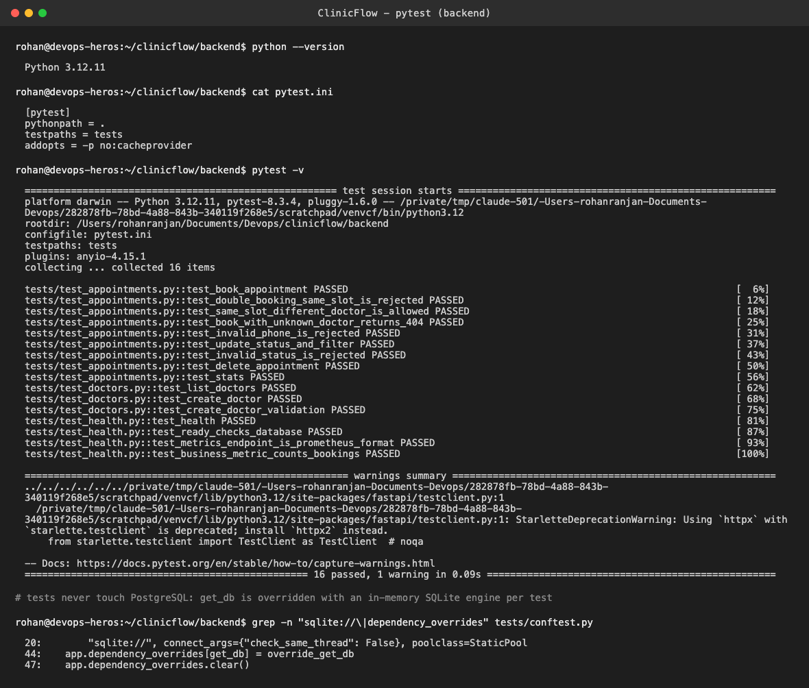

## M3 — Git & GitHub

Public repo: **https://github.com/RohanRanjan250/Devops-project**. Commits are small and describe
the change. `.gitignore` excludes `.env`, `__pycache__`, `node_modules`, `.venv`, Terraform state
and `*.tfvars`.

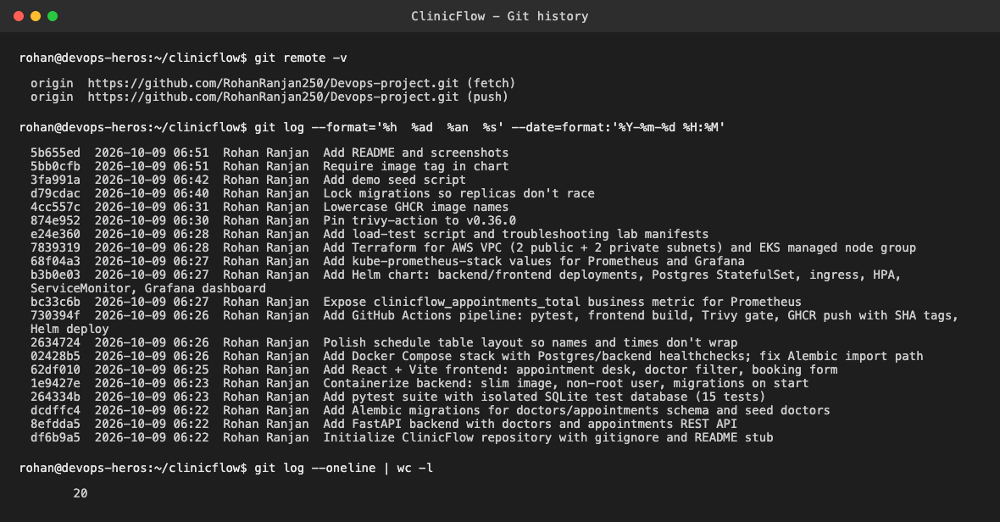

## M4 — Docker

- `backend/Dockerfile`: `python:3.12-slim`, removes pip/setuptools after installing deps (less
  attack surface), runs as **uid 10001**
- `frontend/Dockerfile`: **multi-stage**. `node:22-alpine` builds, and the runtime is
  `nginxinc/nginx-unprivileged` (uid 101, port 8080) with `apk upgrade`
- `docker-compose.yml`: Postgres healthcheck → backend waits for `service_healthy` → frontend
  waits for a healthy backend

```bash
docker compose up --build       # http://localhost:3000  (API: http://localhost:8000/docs)
BASE=http://localhost:8000 scripts/seed-demo.sh
```

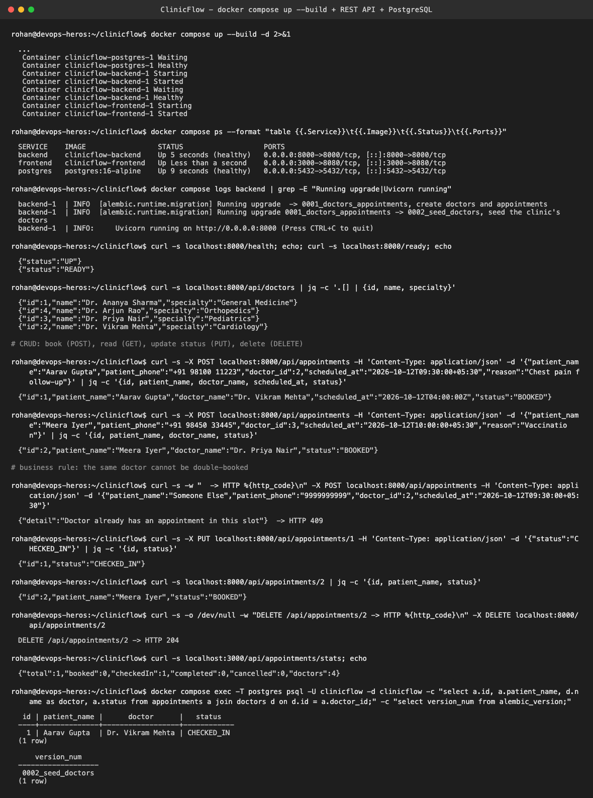

## M5 — CI/CD (GitHub Actions)

`.github/workflows/ci-cd.yml` runs on every push to `main` (and on PRs):
1. **test**: pytest fails the build on any failing test, then `npm ci && npm run build`
2. **build-scan-push**: builds both images, runs the Trivy gate on both, then pushes to
   **GHCR tagged with the commit SHA** (never `latest`)
3. **deploy**: `helm upgrade --install` with the SHA tags. It runs only when a `KUBE_CONFIG_DATA`
   secret is configured, and otherwise exits cleanly.

The first runs failed for real reasons, and I fixed them in the repo:
`aquasecurity/trivy-action@0.28.0` no longer exists (Trivy re-published its action tags with a
`v` prefix in 2026, so it's now pinned to the v0.36.0 commit SHA), and image references must be
lowercase (`RohanRanjan250` → `rohanranjan250`).

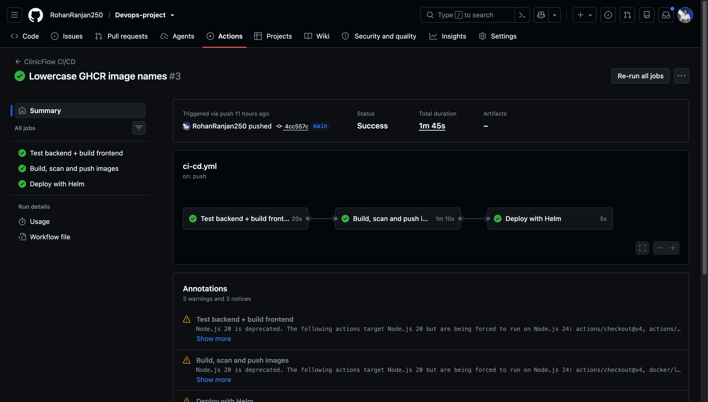

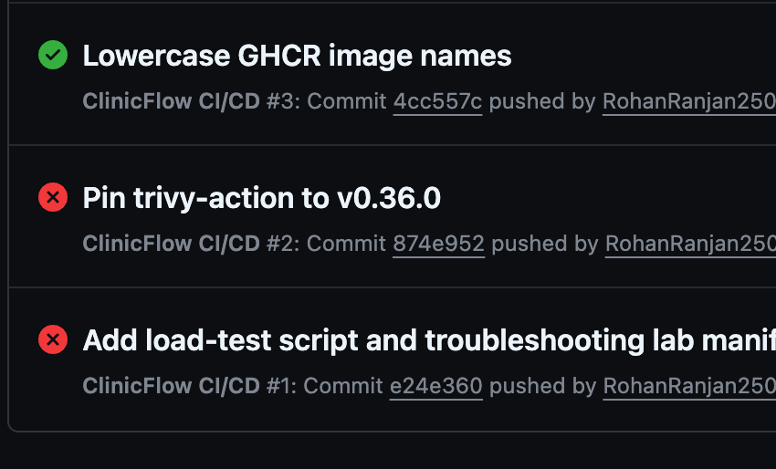

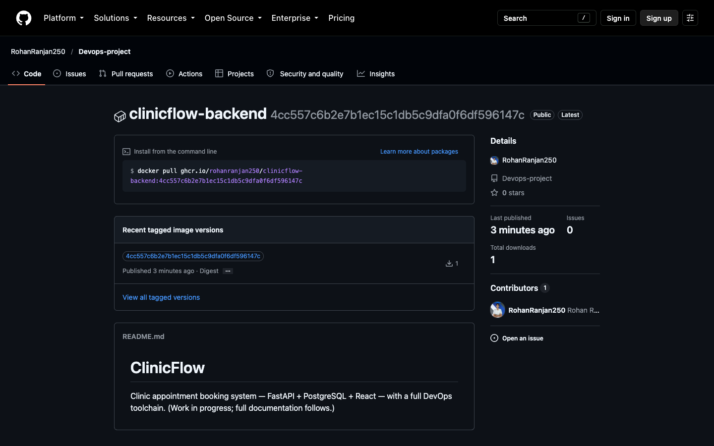

## M6 — DevSecOps (Trivy)

The pipeline runs Trivy on **both** images with `severity: HIGH,CRITICAL`, `ignore-unfixed: true`,
`exit-code: 1`. Any HIGH or CRITICAL vulnerability that already has a fix fails the job, and
nothing gets pushed.

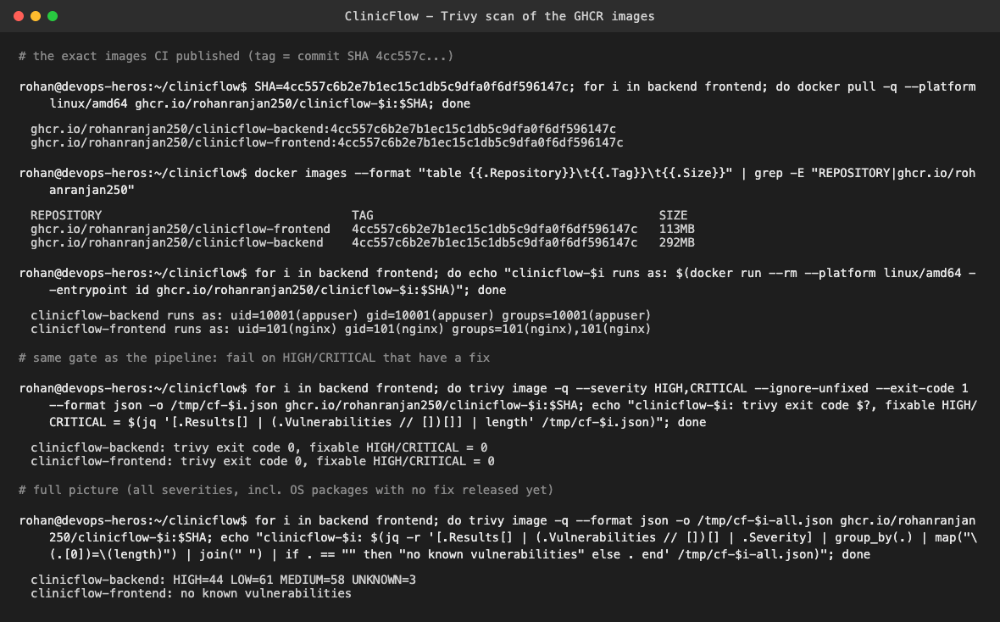

**What the scan says:** I pulled the exact images CI published and scanned them with the same
gate. Both pass with **0 fixable HIGH/CRITICAL**. The frontend has **no known vulnerabilities at
all** (Alpine packages upgraded at build time, only static files plus nginx). The backend still
lists 44 HIGH in Debian base packages, but none of them has a patched version yet, so there is
nothing to upgrade to. Those are exactly what `ignore-unfixed` skips, and they'll disappear on a
rebuild once Debian ships fixes. In TaskBoard, the same gate *failed* (old starlette, old nginx
base), so choosing current dependencies and base images was what made this pass.

## M7 — Terraform (AWS VPC + EKS)

`terraform/` builds a VPC `10.30.0.0/16` across 2 AZs with **2 public subnets** (tagged
`kubernetes.io/role/elb`, NAT) and **2 private subnets** (worker nodes, `internal-elb`), plus an
**EKS 1.31** cluster with a managed node group (`t3.medium`, 2–4 nodes). Variables live in
`variables.tf`, and `terraform.tfvars.example` shows them. No credentials are in the repo.

```bash
cd terraform
cp terraform.tfvars.example terraform.tfvars
terraform init && terraform plan
terraform apply
aws eks update-kubeconfig --region ap-south-1 --name clinicflow-eks
terraform destroy          # when done - NAT gateway + nodes cost money
```

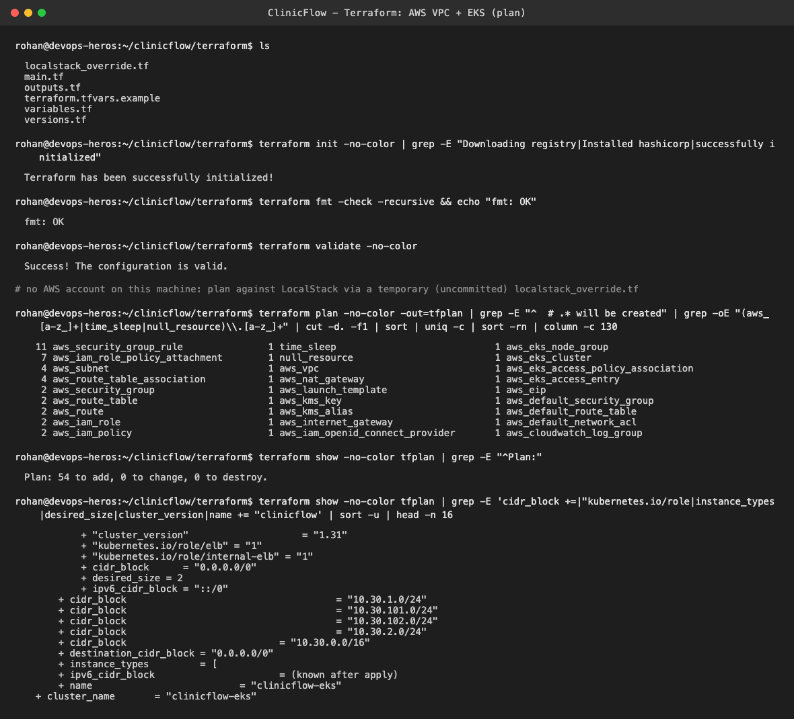

`fmt` and `validate` pass, and `plan` = **54 resources to add**. Because my AWS account denies
EC2/EKS API calls (see "AWS deployment attempt" at the end), this plan was produced against a
local AWS API emulator (LocalStack) through a temporary, uncommitted provider override.
**Apply, the AWS Console screenshots and destroy were blocked by that account restriction.**

## M8 — Kubernetes + Helm

```bash
kubectl apply -f k8s/namespace.yaml
helm upgrade --install clinicflow ./helm/clinicflow -n clinicflow --set backend.tag=<sha> --set frontend.tag=<sha>   # images from GHCR
helm upgrade --install clinicflow ./helm/clinicflow -n clinicflow -f helm/clinicflow/values-dev.yaml   # local kind images
```

The chart (`helm/clinicflow`) contains:
- backend and frontend Deployments (2 replicas each, readiness and liveness probes, resource
  limits, `runAsNonRoot`)
- ClinicFlow's ClusterIP Services `backend:8000` and `frontend:80`
- an Ingress: `/` → frontend, `/api` → backend
- Postgres as a StatefulSet with a PVC, credentials in a Secret
- an HPA on the backend (2–6 replicas, 60% CPU)
- a ServiceMonitor and the Grafana dashboard ConfigMap

The backend has an init container that waits for Postgres. When I first deployed, one backend pod
restarted: both replicas ran `alembic upgrade head` at the same moment and collided on
`alembic_version`. The advisory lock in `alembic/env.py` fixed it. Three fresh installs with 4
replicas each then had 0 restarts and ran the migrations once.

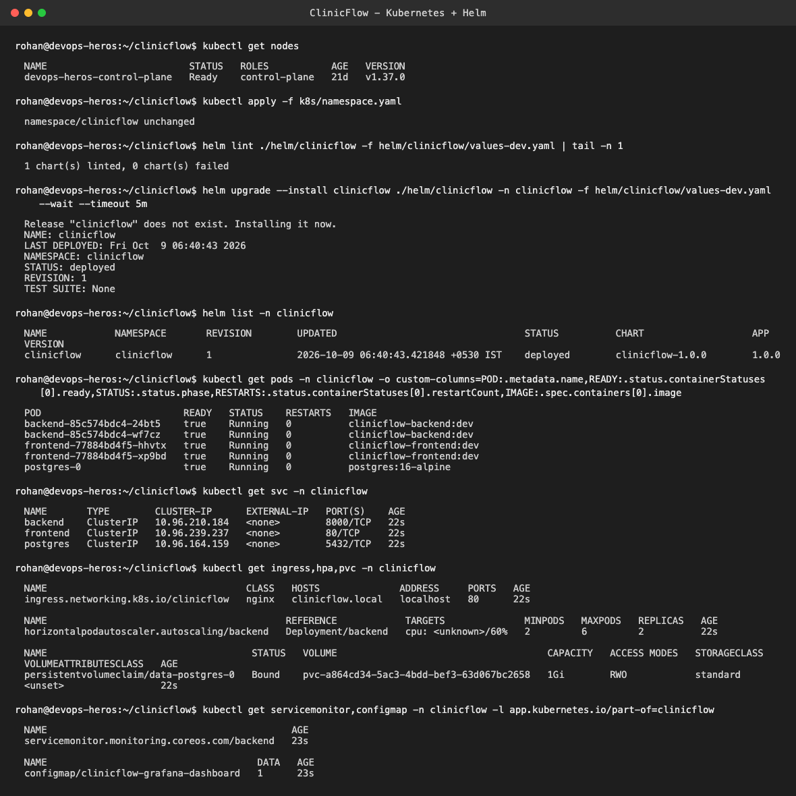

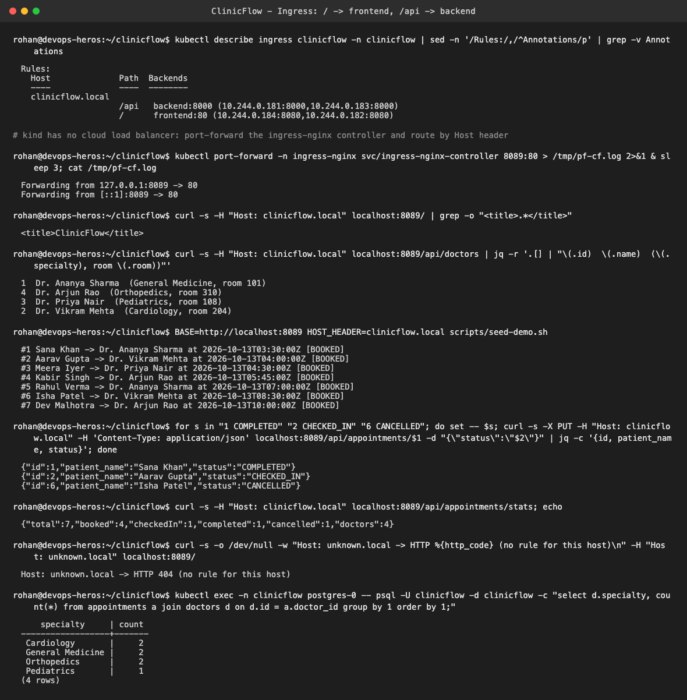

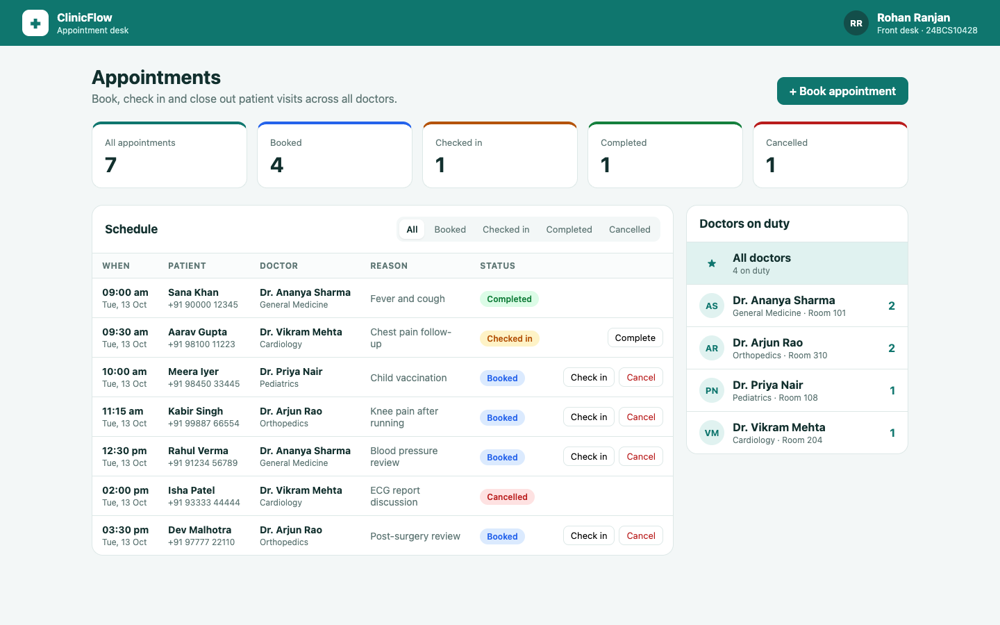

**HPA:** 3 in-cluster load generators plus a "receptionist bot" booking random slots took the
backend from 2 → 4 → 6 replicas within 15 seconds.

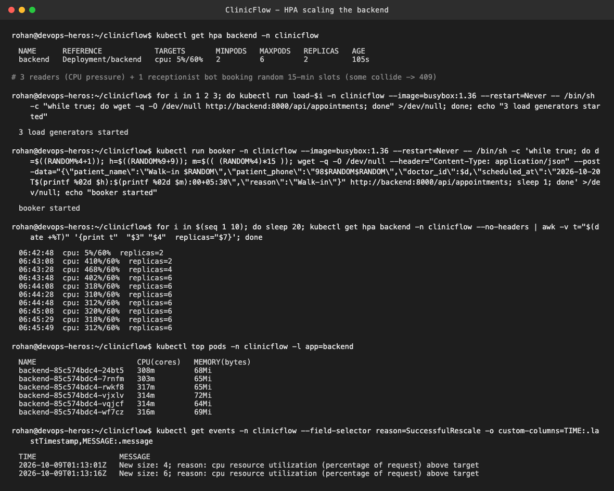

## M9 — Observability (Prometheus + Grafana)

```bash
helm upgrade --install kube-prometheus-stack prometheus-community/kube-prometheus-stack \
  -n monitoring --create-namespace -f monitoring/kube-prometheus-stack-values.yaml
```

- `/metrics` exposes HTTP metrics (`prometheus-fastapi-instrumentator`) **and a business
  counter** `clinicflow_appointments_total{event, specialty}`: booked, checked_in, completed,
  cancelled, rejected_double_booking.
- The chart's **ServiceMonitor** makes Prometheus scrape every backend pod. All 6 HPA replicas
  are `UP`.
- The **Grafana dashboard** ships inside the chart as a ConfigMap labelled `grafana_dashboard: "1"`.
  The Grafana sidecar loads it automatically, with no manual import. Panels: pods up, req/s,
  p95 latency, 5xx ratio, bookings in the last hour, HPA replicas, requests per endpoint,
  p50/p95/p99, appointment events per minute, bookings per specialty, CPU per pod, 4xx/5xx rate.

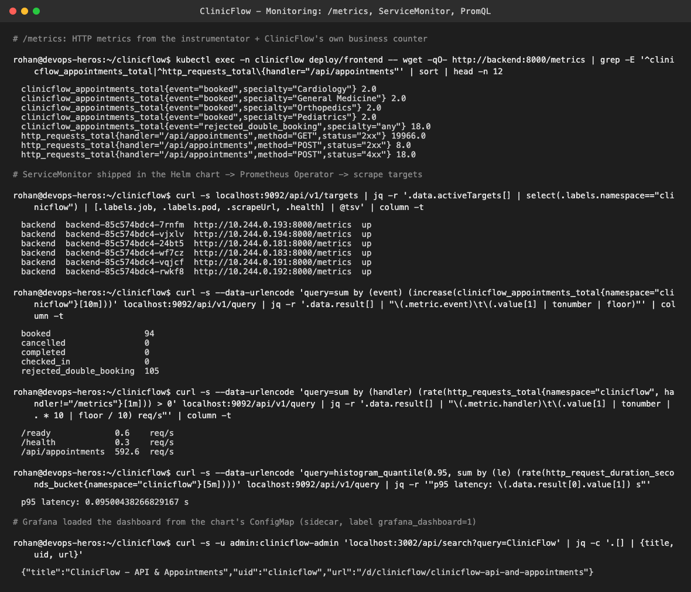

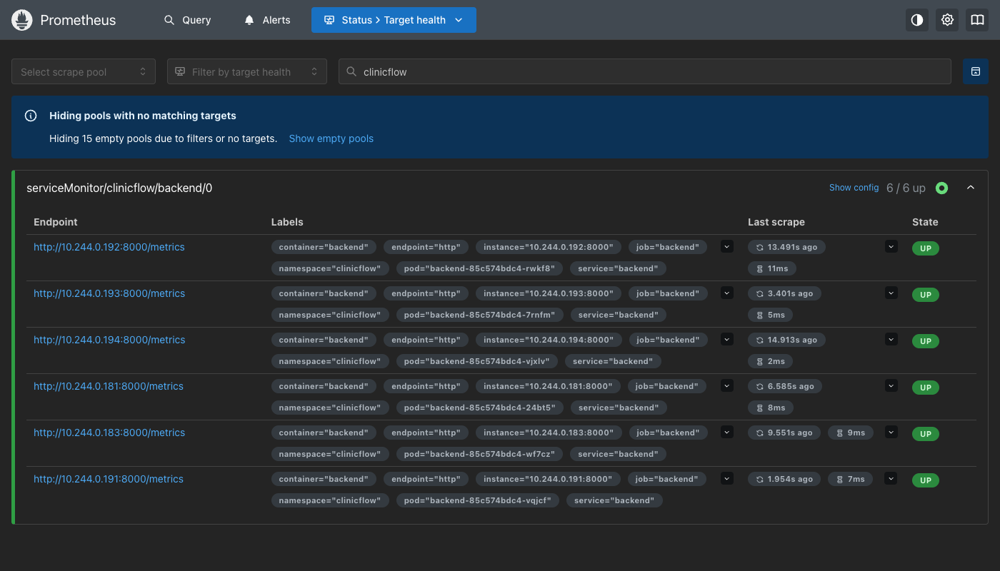

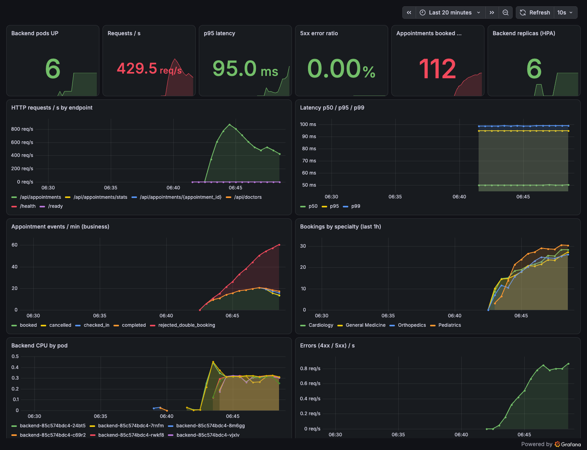

## Troubleshooting labs

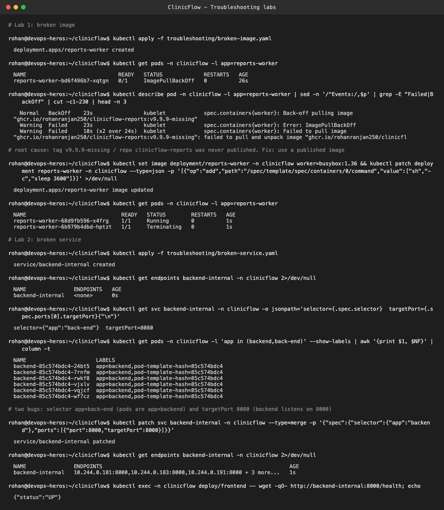

`troubleshooting/broken-image.yaml` gives `ImagePullBackOff`, and `describe` Events show the tag
was never published. `troubleshooting/broken-service.yaml` gives a Service with no endpoints: the
selector says `app=back-end` while the pods are `app=backend`, and the targetPort is 8080 where
the backend listens on 8000. Fixing both gives 6 endpoints and `/health` = UP.

---

## AWS deployment attempt

Everything above ran for real. GitHub Actions and GHCR are real (public repo and public packages),
and Kubernetes ran on a local **kind** cluster. The step I could not complete is applying the
Terraform to AWS. This is what I did and what AWS returned.

**1. Configured the AWS CLI with an IAM user that has full admin rights**

```text
$ aws configure          # region ap-south-1
$ aws sts get-caller-identity
Account: 985937786755    Arn: arn:aws:iam::985937786755:user/rohan-cli
$ aws iam list-attached-user-policies --user-name rohan-cli
PolicyName: AdministratorAccess
```

**2. Every EC2 / EKS call was denied by an AWS Organizations policy, in every region**

```text
$ aws eks list-clusters --region ap-south-1
An error occurred (AccessDeniedException) when calling the ListClusters operation:
User: arn:aws:iam::985937786755:user/rohan-cli is not authorized to perform: eks:ListClusters
... with an explicit deny in a service control policy:
arn:aws:organizations::416503863320:policy/o-wsqvyrdc7r/service_control_policy/p-dt1toy28

$ aws ec2 describe-vpcs --region ap-south-1
An error occurred (UnauthorizedOperation) when calling the DescribeVpcs operation:
... not authorized to perform: ec2:DescribeVpcs with an explicit deny in a service control policy
```

The same denial came back for KMS and CloudWatch Logs (both needed by the EKS module) and in
`us-east-1`, `us-west-2` and `eu-west-1` as well. An explicit deny in a service control policy
overrides IAM permissions, so `AdministratorAccess` doesn't help. Because of this,
`terraform apply` cannot create the VPC or the EKS cluster: its very first AWS calls are denied.

**3. What I tried to remove the block**

- Upgraded the account from the Free plan to the **Paid plan** (`aws freetier get-account-plan-state` → `PAID / ACTIVE`). The deny stayed.
- Created **new access keys** and re-configured the CLI. Same result, because the policy applies to the whole account.
- The policy belongs to the AWS-managed organization of the new "Projects" account experience. Removing it requires **"Activate advanced features"** in the console, which failed every time with *"Your previous activation attempt failed. Please try again."*
- Re-checked over more than a week. The deny never lifted.

Screenshots of these errors are kept with my submission.

**What is ready.** The Terraform code is complete. `fmt`, `validate` and `plan` (54 resources:
VPC, 2 public + 2 private subnets, NAT, EKS cluster, managed node group, IAM) are verified, see
M7 above. On an account without this restriction, the remaining steps are:

```bash
cd terraform && terraform apply                                   # ~15 min
aws eks update-kubeconfig --region ap-south-1 --name clinicflow-eks
kubectl apply -f ../k8s/namespace.yaml
helm upgrade --install clinicflow ../helm/clinicflow -n clinicflow --set backend.tag=<sha> --set frontend.tag=<sha>
terraform destroy
```

For the pipeline to deploy to EKS by itself, add the kubeconfig as the repository secret
`KUBE_CONFIG_DATA` (base64).
